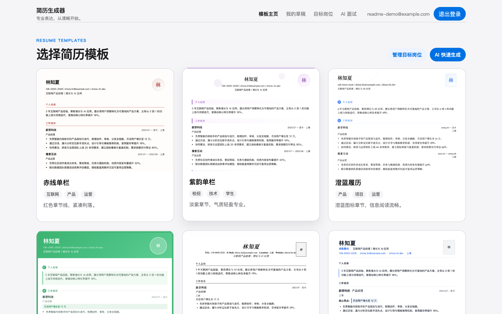
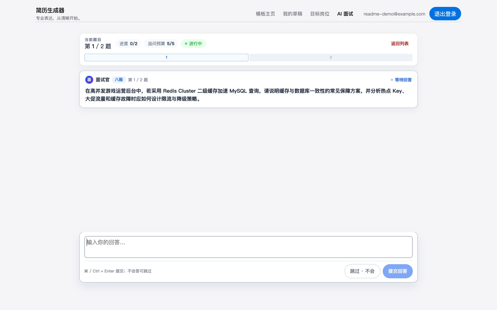
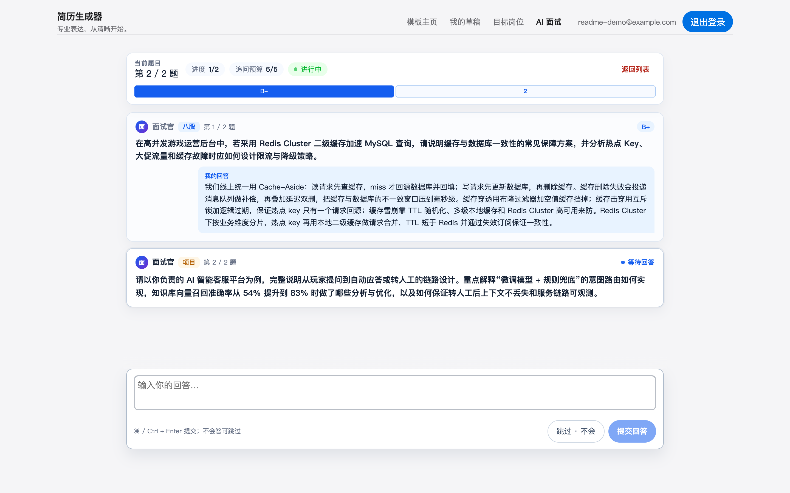
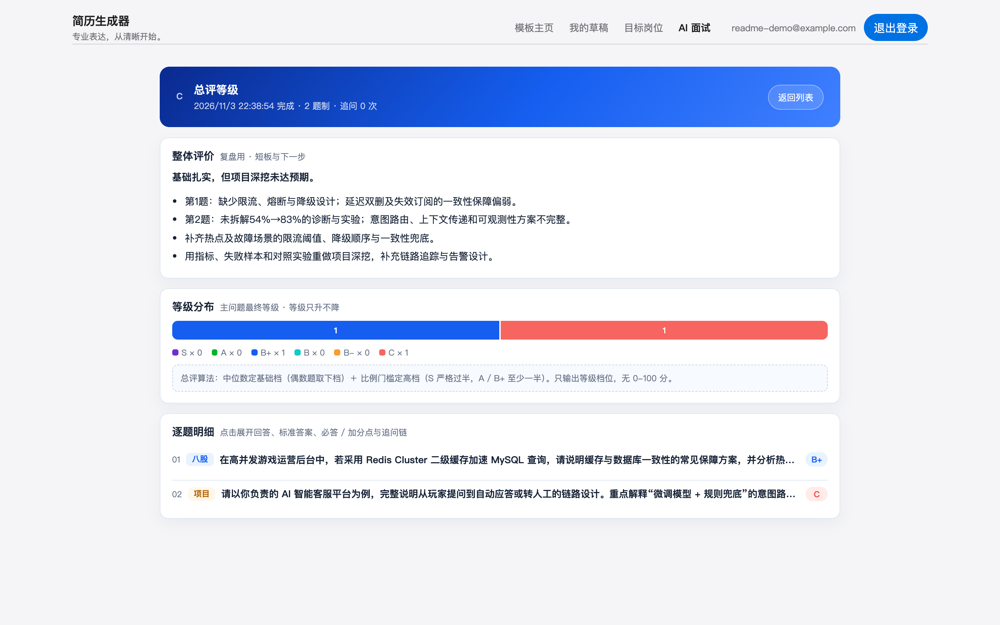
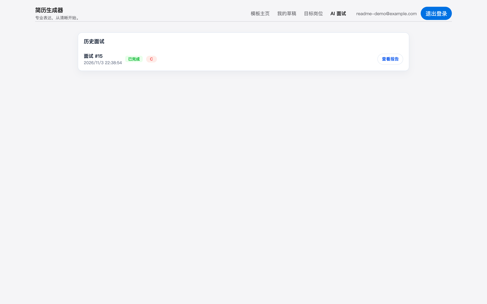
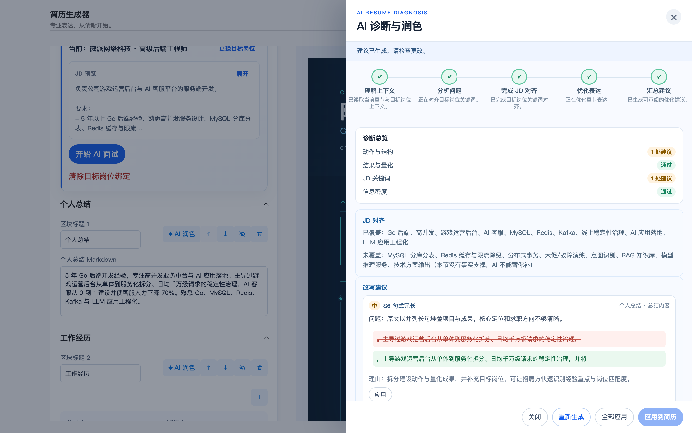
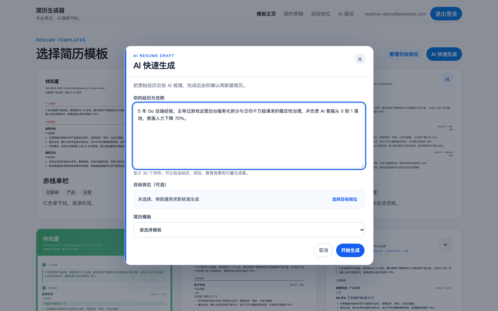
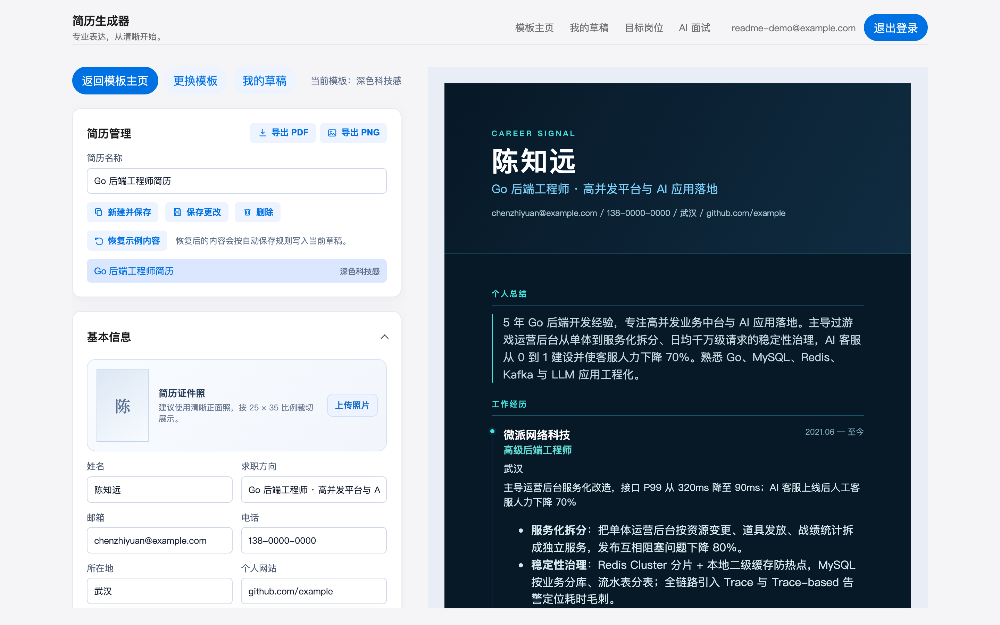
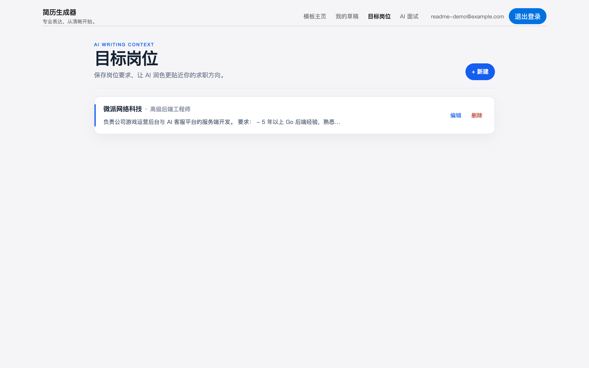
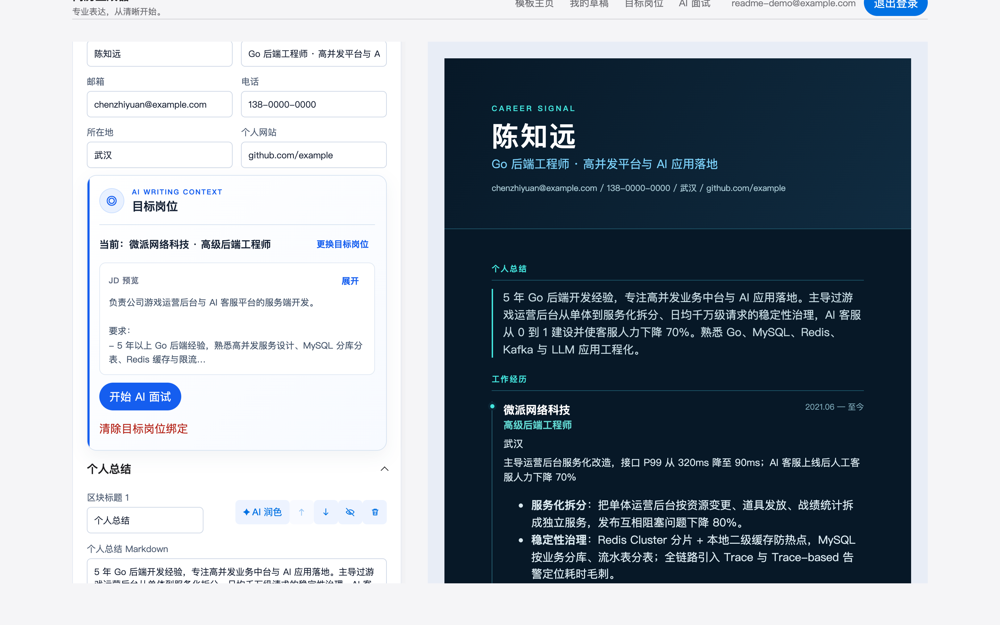

# Resume Pro

> 本地优先的 AI 简历工作台：**模板化编辑器** + **AI 诊断润色** + **AI 模拟面试**。
> Go 后端 + React 前端，数据落在本地 SQLite，面试状态存 Redis，模型走任意 OpenAI 兼容服务。



---

## 这个项目能做什么

| 能力 | 状态 | 一句话说明 |
| --- | --- | --- |
| **AI 模拟面试** | ✅ 已上线 | 结合目标 JD + 你的简历出题，逐题评分（C ~ S 六级），答完给总评报告 |
| **AI 诊断与润色** | ✅ 已上线 | 对简历单个章节做 JD 对齐诊断，生成逐条改写建议，可逐条采纳 |
| **AI 快速生成** | 🟡 界面就绪 | 生成弹窗、流式解析、结果应用全通；**服务端生成逻辑尚未实现**，接口目前返回 `NOT_IMPLEMENTED` |
| 简历工作台 | ✅ 已上线 | 12 套模板、分区块编辑、自动保存、导出 PDF / PNG |
| 目标岗位 | ✅ 已上线 | 维护多份 JD，作为润色与面试的上下文 |
| 账号与隔离 | ✅ 已上线 | 每个账号一个独立租户，简历数据互不可见 |

---

## 一、AI 模拟面试

从编辑器里的「目标岗位」卡片发起，面试官会读你的 JD 和简历，出一道题、评一次分，逐题推进。

### 1. 配置面试：题目总数、标签配额、追问预算


- **题目总数** 与 **各标签数量**（八股 / 算法 / 项目）必须相等，界面会实时校验
- **追问总预算**：全场上限，用尽后禁止追问
- **单问追问上限**：同一道主问题最多被追问几次
- 开始后配置会生成快照并锁定，面试中不可改

### 2. 面试进行中：逐题对话 + 贴底输入坞



- 顶部进度轨显示当前题号、已答进度、剩余追问预算
- 只渲染到当前题为止，**后续题面不会提前摊开**
- 不会答可以「跳过 · 不会」，该题按最低档 C 结算

### 3. 逐题评分：答完立刻给等级



每一题答完立刻返回等级徽标，并给出必答点 / 加分点，方便对照复盘。

### 4. 面试报告：总评 + 等级分布 + 逐题明细



- **整体评价**按「结论 / 短板 / 下一步」三段式输出，短板直接带题号
- **等级分布**展示各档位命中数量，并写明总评算法
  （中位数定基础档、偶数题取下档；S 需严格过半，A / B+ 需至少一半）
- **逐题明细**可展开查看我的回答、标准答案、必答点与加分点

### 5. 历史面试



---

## 二、AI 诊断与润色

在编辑器的任意可改写区块点「✦ AI 润色」，AI 会先读取当前章节和绑定的目标岗位，再给出诊断与改写建议。



- **五阶段流式进度**：理解上下文 → 分析问题 → 完成 JD 对齐 → 优化表达 → 汇总建议
- **诊断总览**：动作与结构、结果与量化、JD 关键词、信息密度四项检查
- **JD 对齐**：列出已覆盖 / 未覆盖关键词，未覆盖项会明确标注「本节没有事实支撑，AI 不能替你补」
- **改写建议**：逐条可「应用 / 撤销」，也可以「全部应用」或「应用到简历」
- 安全兜底：模型输出截断、格式不符、章节不匹配时都有对应错误提示，不会静默写坏简历

### 润色范围

| 章节类型 | 可改写字段 |
| --- | --- |
| `summary` | `markdown` |
| `work` / `internship` | 条目的 `achievements`、`highlightsMarkdown` |
| `project` | 条目的 `introduction`、`achievements`、`highlightsMarkdown` |

公司、职位、日期、学校等事实字段不在改写范围内——AI 只改表达，不改事实。

---

## 三、AI 快速生成（界面就绪，服务端待补）

把原始经历交给 AI 梳理，生成后由你确认再新建简历。



前端链路已经打通：填经历 → 选模板 → 绑定目标岗位 → 流式生成 → 结果摘要 → 「应用到新建简历」。

> ⚠️ **当前状态**：服务端生成逻辑是空实现，`POST /api/ai/resumes/generate` 返回
> `NOT_IMPLEMENTED: from-scratch generate is TODO`。提示词模板 `system_generate.tmpl`、
> SSE 事件契约与前端消费逻辑均已就绪，补齐服务端 ResumeDocument schema 与生成流即可启用。
> 详见 [backend/internal/ai/service.go](backend/internal/ai/service.go) 的 `GenerateResume`。

---

## 四、简历工作台



- 12 套模板：极简单栏 / 紫韵单栏 / 澄蓝履历 / 学术衬线 / 蓝色侧栏 / 藏青装订线 等
- 左侧分区块编辑，右侧实时预览；点击预览里的区块标题可反向定位到编辑器对应位置
- 自动保存 + 手动保存，简历按账号隔离存储
- 导出 PDF / PNG

### 目标岗位





岗位要求是 AI 润色的对齐依据，也是面试出题的上下文。简历绑定岗位后，卡片上直接出现「开始 AI 面试」入口。

---

## 技术栈与架构

| 层 | 选型 |
| --- | --- |
| 后端 | Go 1.26 + Gin + SQLite（本地库）+ Redis（面试状态 checkpoint） |
| 前端 | React 18 + TypeScript 5.6 + Vite 5 |
| 模型 | 任意 OpenAI 兼容服务（DeepSeek / MiniMax / OpenAI …），SSE 流式返回 |

```text
backend/
  cmd/server/            进程入口：装配服务、加载 .env、连接 Redis
  internal/
    ai/                  提示词、LLM 调用、输出 schema 校验、建议合并
    interview/           面试编排：出题、评分、总评算法、Redis checkpoint
    resumesvc/           简历与目标岗位的业务编排
    httpapi/             HTTP 层：鉴权、入参解码、DTO 转换、错误映射
    store/               SQLite 仓储与迁移
frontend/src/
  components/            编辑器、面试对话、润色面板、模板等
  templates/             12 套模板渲染器
  api/                   类型化 API 客户端
docs/screenshots/        README 配图
```

AI 链路统一走 SSE：后端只负责提示词、调用与校验，数据归属和租户隔离在 HTTP 与持久化层完成。

---

## 快速开始

### 依赖

- Go 1.22+
- Node.js 20+
- Redis（仅 AI 面试需要）
- 一个 OpenAI 兼容服务的 API Key

### 配置

把下面变量写进仓库根目录的 `.env`（参考 [.env.example](.env.example)），后端启动时自动加载，无需手动 export。

| 变量 | 默认值 | 说明 |
| --- | --- | --- |
| `OPENAI_API_KEY` | 无 | 必需，模型服务的 API Key |
| `OPENAI_BASE_URL` | `https://api.deepseek.com/v1` | OpenAI 兼容服务地址 |
| `OPENAI_MODEL` | `deepseek-chat` | 模型名 |
| `AI_MAX_TOKENS` | `4096` | 单次响应 token 上限 |
| `AI_REQUEST_TIMEOUT` | `60s` | 上游请求超时 |
| `AI_MAX_RETRIES` | `1` | 输出未通过 schema 校验后的重试次数（0 ~ 10） |
| `AI_REASONING_EFFORT` | 无 | 推理档位：`low` / `medium` / `high` / `xhigh` / `max` |
| `REDIS_ADDR` | `127.0.0.1:6379` | Redis 地址，面试状态存储 |
| `REDIS_PASSWORD` | 无 | Redis 密码 |
| `REDIS_DB` | `0` | Redis 库号 |
| `JWT_SECRET` | 无 | 生产必需，至少 32 字符；本地留空会用开发密钥 |
| `APP_ENV` | `development` | 设为 `development` 才开放本地免密登录端点 |
| `COOKIE_SECURE` | `false` | HTTPS 下设为 `true` |
| `RESUME_DB_PATH` | `./resume.db` | SQLite 文件路径 |

> 💡 `MiniMax-M3.1-Flash` 默认 `max` 推理档会把 token 预算烧在隐藏思考上导致正文截断，配 `AI_REASONING_EFFORT=low` 可解决。

### 启动

```bash
# 后端（http://127.0.0.1:8080）
cd backend && go run ./cmd/server

# 前端（http://127.0.0.1:5173）
cd frontend && npm install && npm run dev
```

也可以直接用 `./scripts/restart.sh`（`all` / `backend` / `frontend`）。

### 复现 README 配图

配图是真实跑出来的，不是设计稿：

```bash
cd frontend
node scripts/seed-readme-demo.mjs   # 造一份演示用的简历与目标岗位
node scripts/screenshot-readme.mjs  # 截图到 docs/screenshots/
```

---

## API 一览

| 方法 | 路径 | 说明 |
| --- | --- | --- |
| POST | `/api/auth/register` / `/api/auth/login` | 注册 / 登录，下发 HttpOnly Cookie |
| GET | `/api/auth/me` | 当前用户 |
| POST | `/api/dev/login` | 仅 `APP_ENV=development` 且回环请求可用 |
| GET/POST | `/api/resumes` | 简历列表 / 创建 |
| GET/PUT/DELETE | `/api/resumes/:id` | 简历读写删（按租户隔离） |
| GET/POST | `/api/target-jobs` | 目标岗位列表 / 创建 |
| PUT/DELETE | `/api/target-jobs/:id` | 目标岗位更新 / 删除 |
| POST | `/api/ai/resumes/:id/section/rewrite` | 章节润色（SSE 流） |
| POST | `/api/ai/resumes/generate` | 从零生成简历（**待实现**） |
| POST | `/api/interviews` | 创建面试，返回首题 |
| GET | `/api/interviews` | 面试列表 |
| POST | `/api/interviews/:id/answer` | 提交回答（`{answer?, skip?}`） |
| GET | `/api/interviews/:id/questions` | 题目与评分明细 |
| POST | `/api/interviews/:id/abort` | 放弃面试 |
| POST | `/api/uploads/avatar` | 上传头像 |

---

## 开发与验证

```bash
cd backend && go build ./... && go test ./...
cd frontend && npm test -- --run && npm run build
```

## 已知限制

- **AI 快速生成的服务端实现缺失**，见上文第三节
- **AI 面试依赖 Redis**，未配置时后端启动告警，面试接口统一返回 503，其它功能不受影响
- **未配置 `OPENAI_API_KEY`** 时服务仍可启动，需登录的 AI 路由返回 503
- 生产部署需自行补 HTTPS、CORS 白名单与 CSRF 保护（当前按同源部署设计）
